## what is data science?
Data science ek technique ha jis ma hum data collect,analyze or understand karta ha ta ka data sa useful information or decision nekala ja saka ya data scienca kahlata ha.

- Environment science ka department hama batata ha ka ic din barish ho ge ya ic din badil ayya ga ya taz hava aya ge flood ka masla ho ga ya sab data science ma ata ha.
- Busness developement mesal ka tor par Amazon,Google in ko busnass egencies menage karti ha hum na koi cheas buy karni ha hum google par search karta ha to us ka adds facebook ,tiktok par ana shro ho gata ha ya sab data science model ha.    
## What is bio-informatics?
Bioinformatics sa murad ham computer or sofware ka use kar ka biology information (hum biology or computer science dono ko mila kar data )ko store ,analyze or understand karta ha.

- For example gab koi vacean bani gati ha to us ka bara ma bataya gata ha ka ic ka 90 percent side effect ha ya ic ma ya ya genes ka istamal kaya gaya.

>Python sab sa zayada use hona vali programming language ha.

Python ko bahat sa log use karta ha ya Programmer,Data analyst,Matamaticions,Acountent,Network engineers or every body can use python.
>Python is a open source programming language.

Puthon ke madad sa ham same task ko bar bar repeat kar sakta ha.

# Lacture -2
>Ten important steps to become a data scientist.

1-Laran basic matamatics

2-Laran basic statistics

3-Learn a programming language (Python or R)

4-Data wrangling and data cleaning

5-Data visualization   

6-Machine/ Deep learning Alogrithms

7-Linux,Coda ,Git or enviornmnt

8-Open source database 

9-Domain sapecific,Data science or project.

10-Motivation and Good PC

# Lacture -3 (Day 1a) 

Jab ham data science  par kam karta ha to python ka use hota ha ic leya ham data science sa pahla python ko explain kara ga.Phla lacture ma hum data science ka bara ham dic kas kar chokaa ha.
- Data science ek field ha gs ma hum data collect,analyze or understand karta ha ta ka data sa useful informatin banya ga sakaa or decision nekala ja saka.   

## Machine learning sa kaya murad ha?

Machine learning artficial intelligence ka ak component hota ha ic ma computer ma data or exemple deye gati haa or computer in example sa pattern sekta ha or fature ma decision lana ke koshsh karta ha.

simple 

Machine Learning ka matlab hai computer ko data se seekhna sikhana, taake woh naye data ko dekh kar prediction ya decision kar sake

### Example

Youtube apke watch hitory or dosra signl ko analyze kar ka andaza laga sakta ha ka ap ko kon si video passand aa sakti haa

# Lacture -4(Day 1)

Sab sa pahla ham na window ma python ko run kasa karna ha?

pahla hama python ko install karna para ga.phir ham apni window par command prompt ko click kara ga or write kara ga python --version or enter kara ga agar to python ka version show ho gya to python installed ha nahi to hama install kari para ge

Agar download nahi ha to ham google par search kara ga **python.org** or yaha sa window par ga kar ham download kara ga.

Ab hum dobara sa search kara ga **Python --version** to apna version show karvaa ge .or python sa bahir gana ka laya hum exit() write kara ga.

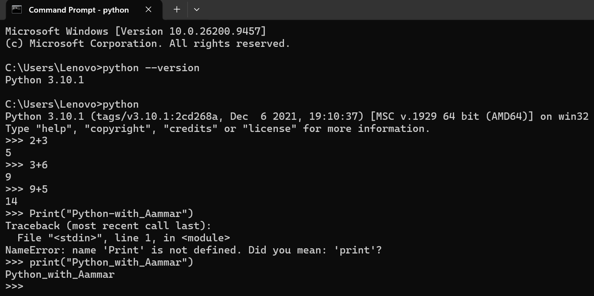

Ic ka alva hum search bar python search kara ga to install python ka terminal open ho gya ga or jo be command write kara ga vo python ma open ho ge

python ko us ke lenguage ka elava koi instruction de gya to vo usa perfom nahi karta 

- Example

Agar hum python ko kahta ha ka **What is 2+3** to vo ic ka koi javab nahi da ge ic ka elava hum ic ko directly khta ha ka 2+3 to vo foran us ka javab da ge.

>Python ko use karna ka method:
print ka p small or brakts ma vo word write karna go display karvana ho US ko colon ma likhna ha.

- Example

print("Hello World")

Hello Worid

Python case sencitive language ha agar print ka p capital lakha ga to ya execute nahi kara ga

Ic ka bad hum simply disktop par ak text file create karta ha ic ma be ham apni commands write kar sakta ha go python understand kar saka.

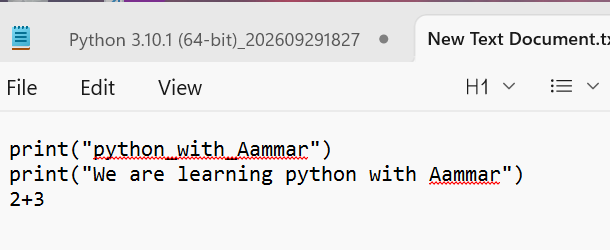 

Agar ham cammond prompt par write kara ga *cd Desktop* to desktop par chala gya ga phir yaha ham na go folder banaya ha *cd adil_javed* ka nam sa likha ga to vo folder open ho gya ga,agar open folder ka back gana ha to ham us ka aga cd double dot (cd ..) likha ga to vo folder vapis ho gya ga.

- Agar ham kese folder ka samana code single . (code .) write karta ha to to folder VS code ma open ho ga.

- Agar ham na koi folder banana ha to ham cd Desktop write kara ga next **mkdir** write kar ka phir go folder ko nam dana ha vo write kara ga (mkdir adil_javed) to folder desktop par ban gaya ga.

- Agar hm command prompt par *dir* write kara ga to vo desktop ka all folders ko show karva da ga   

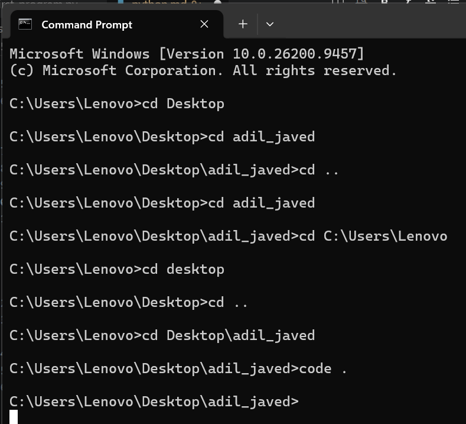

Phir ham VS code ko instal karta ha or ic ma python ke extension instal karta ha ya be python ko chlana aa ka laya bahter cerdar ada karta ha VS code ma hum ak file banata ha us ko ham 01_first_program.py ka nam dataa ha jasa he ham .py write karta ha to file open ho gya ge.

Ic python ke file ma ak program lakhaa ga go hama terminal ma show karvaa ga 

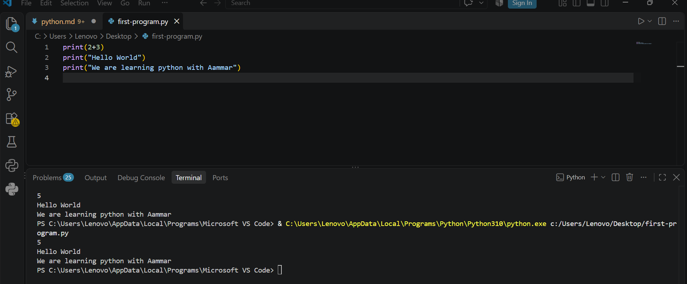

# Lacture -5 (Day 2)

Ic ma ham operater ka use ka bara ma parra ga ko vo pythn ma kasa kam karta ha.

Ham VS code ma ak new file create kara ga jis ko ham **01_operater.py** ka nam da ga. phir simply ham 2+3,3-2,2*3,8/4 or 9/4 to vo in ka correct answer da ga. ham 9//4 write kara ga to error da ga  

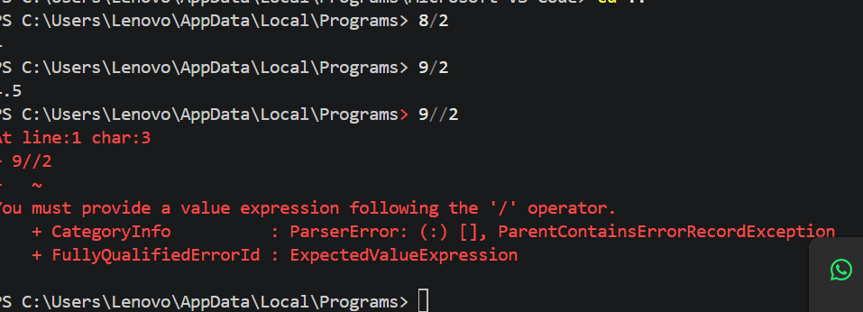

Python ma gab ham operater ko use karta haa to spaces ka koi issue nahi hota  

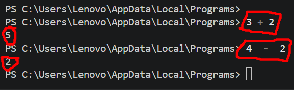

Above picture ma ham na spaces be deye ha lakin answer corect aya ha.

Agar ham code ko comments ma change kar da ga to vo run  yaa execute nahi ho ga yani code ka sat hash # laga da ga to vo code run nahi ho ga.agla code par chala gya ga 

python PEMDAS ke sequance ma kam karta ha .

> PEMADS stand for Parenthesis Exponents Multiply Devide Addition Sebstraction.
>
> python ma code ke execution left to right ma hoti ha yani M D A S. 

Terminal ma gab ham operaters ka use kar raha hota ha to us ma spaces ka koi issue nahi hota numbers or operaters ka darmyan getni marzi spaces ho execute ho gya ge spaces ke vaga sa answer par koi farq nahi parta.See on below picture.

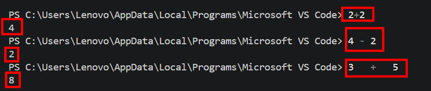

Phala ham operater ke symbols ko understand karta ha 

    Addition +, Subsetrection -, Multiplication *, devision /,Modules % , or kisi number ke power ka leya ham double staric (**) ka use karta ha (or ak bat terminal ma kici be number ke power double staric sa nahi find hoti).   

Python ma kuch gagoo par hama value points ma chayhee hote ha or baz time hama value whole numbers ma zarorat hote ha agar value points ma aya rahee ho to or hama whole numbers ma zarorat ho to ham simply double divide ka use karta ha yani double slach (//) ka use karta ha.

Strings sa kaya murad ha?

    Strings kisi be letter,word,name or sentence ko kahta ha.Ham strings ke maded sa computer  ko batataa ha ka ya latters ya words ha numbers nahi ha computer hir cheez ko number he samgata.

    Python ma string ko represent karna ka leya quotes ka use kaya gata ha 
    - Strings ka leya ham single, double or tripple quotes ("") ka use be kar sakta ha Koi be type use kar laya to command execute hon gaya ge.

- Quotes ke kuch types haan or un ke kucch explanation  
karta ha.

- Gab ham simple text likh raha ha to ham single ya double quotes ma sa koi be use kar sakta ha, laken kuch places par doubule quotes ka use lazmi hota ha khu ka un ma already single quotes ka use hota ha. For example ("Adil's laptop)  ("School's") etc.

- Or tripple quotes ('''  ''') ka use multiple lines write karna ka leya hota ha ham kici ko message send karta ha to ham cahtaa ha ka message ko line by line send kar saka to ic ka leya ham tripple quotes ka use karta ha.

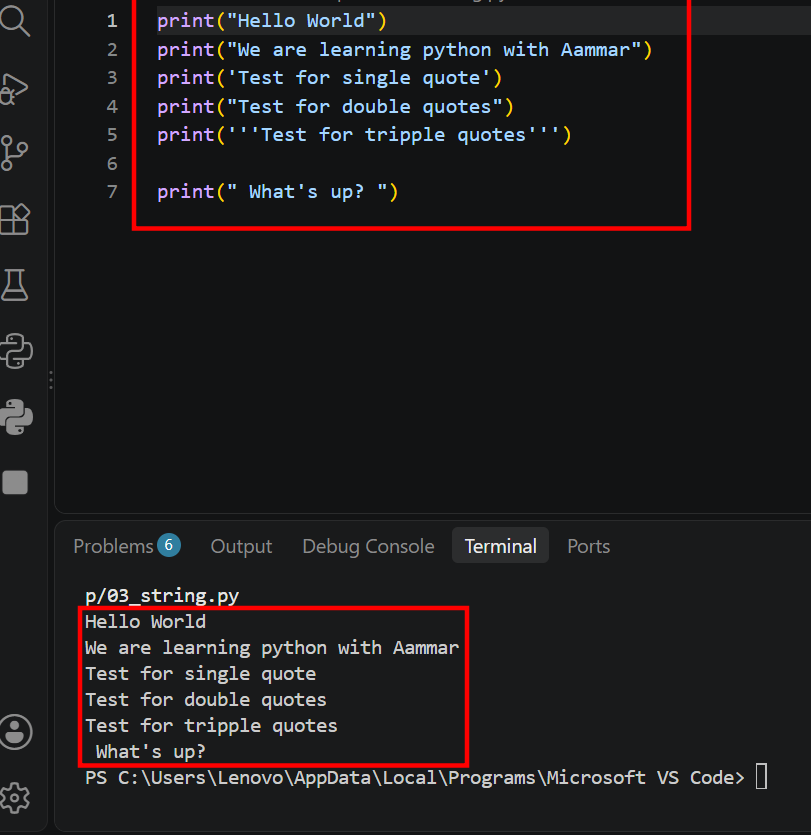

Ic ka bad ham comments ka bara ma partaa ha ka comments kaya ha or comments ko khub use karta ha or kasa use karta ha.

- Programer code ko understand karna ka laya comments use karta ha ta ka vo code ka purpose ko understand kar ska.Python ma ham jis line ko comment out kar da to python ma execute nahi karta.
- Comment out karna ka 2 method ha ak to simply jic line ka sath hash tag (#) laga da ga to vo line comments out ho gay ge or dosraa method ya ha ka ham jin line ko comments out ya comment in karna cahtaya ha un ko select kara ga or "ctrl + / " (control plus curve slach) ko press kara ga.
  
Ic ka bad ham variable ka bara ma bat karta ha ka ariable kaya ha or ham khu use karta ha or kaha use karta ha.
- Variable sa murad kisi be nam ya label ka use kar ka ha value ya data to temporary tor par store karat ha ta ka ham ic ko bad ma use kar saka . ya different object hota ha jin ka ander data ya value store hote ha.
- Mesal ka tor par ham na variable x = "Adil" ic ma ham na variable x ma Adil ko store kardaya ha as yaha x as avariable use ho raha ha or Adil as a value, or ya string variable ha or y = 5 to ya numaric variable ha.
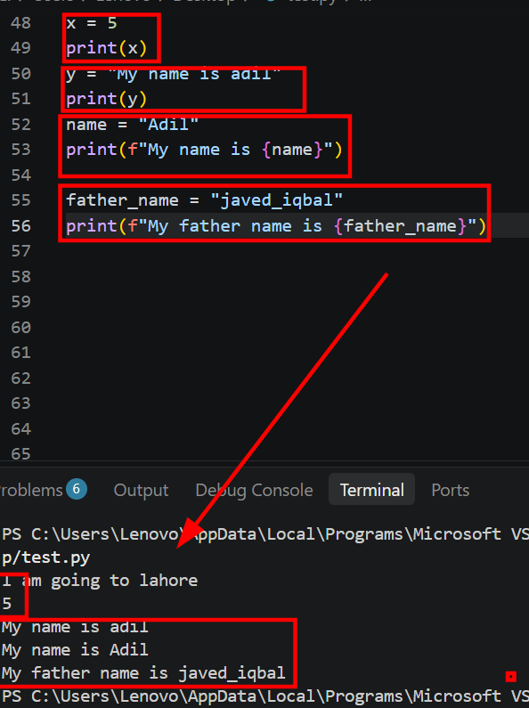

- Agar ham na variable ke class ya type ko check karna ha to ham simply print(type(x/y)) ic tara ham jic variable ke type ko check karna chatyaa ho ga hum us ko ic ko brackets ma write kara ga to type check ho gya ge.

> Variable ko use karna ka kuch rule be hota ha.
- Ham variables ma numbers, latters or underscore ka elava kuch or use nahi kar sakta.
- Ham variable ko numbers sa start nahi kar sakta for example 2y, 3x,5x etc.
- Ham variable ka nam ma spaces ka use nahi kar sakta.
- Variable ka nam ma keywords ka use nahi karna .mesal ka tor par *break, median,test etc.*
- Variable ka nam short or simple hona caheyaa.
- Python ak case sencitive languge ha hama lower case latter ka use karna chayaa.

Input variable kaya ha? input variable sa murad python ma program user sa information mangta ha or variable us information ko store karta ha. Input variable user sa data lataa ha mesal ka tor par hum write karta ha ka 
- collection_of_cars = input w rite kar ka ik question banata ha ta ka vo terminal ma ak question ke tara show hota ha below picture ma show ho raha ha.

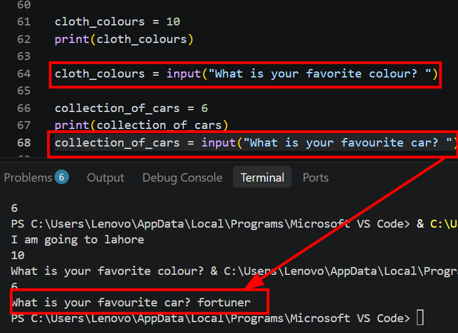

Ic ka bad ham conditional operaters ka bara ma parta ha sab sa pahla ham in ke symbols ko understand karta ha.

logical operaters ke value always *True,False or yes,no or 0,1* ma hoti ha.

- Equal ka leya                         ==
- Not equal ka leya                     !=
- Greater then ka leya                   >
- Less then ka leya                      <
- Greater then or equal to ka leya       >=
- Less then or equal to ka leya          <=

Ab ham in operaters ko use karta ha mesal ka tor par ham 4 ==4 to answer nahi aya ga ya koi or question karta ha ka 3-2 to python error show kavaaa ga lakin agar terminal ma ic tara writ e kara ga to answer correct hama mil gaya ga.
- laken python ko hama proper command dana para ge mesal ka tor par ham na 4==4 ko calculate karna ha to ha ya command darya ga 
- print(4==4) to us ka hama answer mil gaya ga ka ya dono equal ha answer true ma ho ga.
- Agar ham pochata ha ka 5>7  matlib print(5>7) to ka 5 bara ha 7 sa answer false ma show ho ga 
- Ak simple example ha ka ma out country gana cahtaa ho mari age 16 sal ha laken kisi be country ma jana ka leya age ka 18 hona zarori ha vasa to question bohat easy ha magar ham python ma ic question ka answer kasa find kara ga hama proper commands dana para gee ham logical operaters ka use kara ga. for example see below picture.

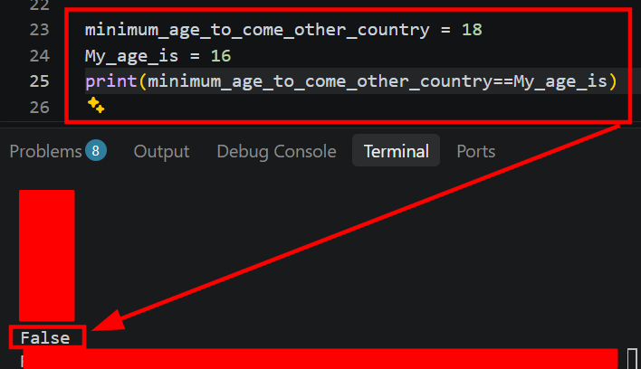

Above picture ma ham na python ko ic ke language ma apna problem batyaa ha to us na hama correct answer deya ha false matlb mari age kam ha ma nahi ga sakta.

Python ma ham kisi be variable ke types ko check kar sakta ha ka ic variable ke type kaya ha.for example ham na variable x ma value "Adil" store ke , y ma 10 or z ma 10.2 store ke ha ab ham in variable ke type ko check karna chatya ha hum simply ya command apply kara ga to hama type ka pata chal gaya ga.**print(type(x/y/z))** brackets ma hum un value ko write kara ga jin ka variable ke type ko find karna ha.

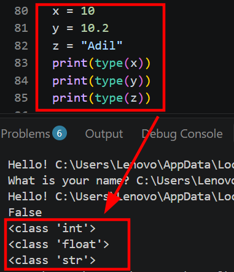

Phir ham if,else or ilef ka bara ma parta ha ka ya ha kaya or in ka use kaya.sub ca pahla ham if ka bara parta ha ka if kaya or ic ka use.
- if ak conditional statement ka leya use hota ha jis ka matlib ha agar, if ko hum us vaqt use karta ha ka gab hamari hovhish hoti ha ka statement us vaqt execute ho gab conditional true ho Mutlb school gana ka leya required age 5 sal ha or mara bhi age 4 sal ha to print ho ga ka mara bhi school ni gaya ga ic tara ke condition ma hum if statement ka use kara ga.
- else statement ka bara ma bat karta ha ka else ka matlib ha warna, yani gab if condition false ho gaya to else vala code execute ho ga jis tara ham na pahla ak example par bat ke ha ka agar if vali condition true ho ge to maara bhi school gaya ga or agar false ha to print ho ga ka vo school ni gaya ga else print kara ge ka ya school ni gaya ga.

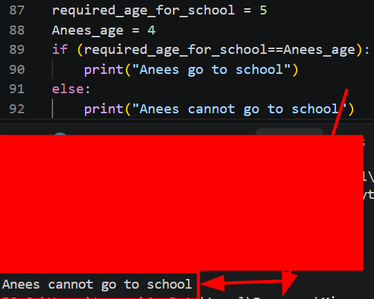

Elif do ya do sa zeyada conditions ka leya use hote ha ka gab if vali condition false ho gaya ge to elif vali condition check ho ge agar elif vali condition be false ho ge to phir else vali condition execute ho ge.

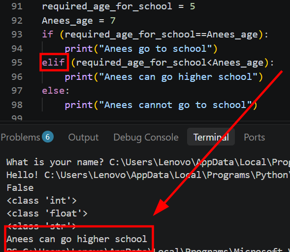

Above picture ma ham na ak example perform kae ha ic ma school gana ke age 5 sal ha or Anees ke age 7 sal ha yha par ham na tenoo conditional statement ka use keya ha matlib **if,elif or else** 
- Agar anees ke age 5 sal hoti to print hot ka anees school gaya ga.
- Anees ke age 7 sal ha yani school ke aga sa zeyada haa to print ho ga ka anees higher school gaya ga.(or ya condition above picture ma print ha).
- Agar anees ke age 5 sal sa kam ha to yaha if or elif vali conditions false ho geye haa yaha par else vali condition print ho ge yani anees school nahi gaya ga.

>Function kaya ha or hum ic ko khu use karta ha?
Function code ka asa hesa ya block hota ha go kisi spacific task ko perform kartna ha.Hum function ko ak bar banata ha or or bar bar use kar sakta ha 
- **def** python ko batata ha ka ham ak function bana rakhaa ha 
- Ham function ko koi be name da sakta ha  apni marzi ka.

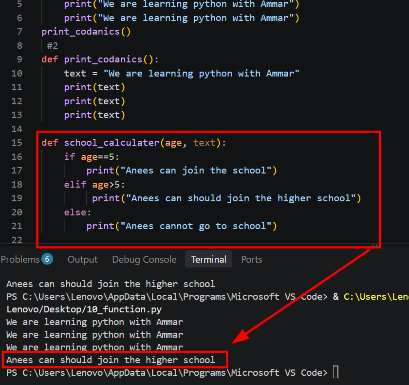

Above picture ma ham na function ko practicaly use keya ha or function ma ham na conditional statement ka use kaeya ha ka if, elif or else kasa kam karta ha or.

Ac ka bad ham loops ka bara parta ha ka loop kaya ha or in ka kaya use haa.

Loop sa murad kici bi kam ya code ko bar bar repeat karna ka tarequa.Loop computer co batata ha ka us vaqat tak ic code ya kam ko repeat karna ha gab tak condition pori na ho gaya.
Loop ko ham us vaqat use karta ha gab ham na ak he kam ko bar bar repeat karna hota ha to ta ka hammaa bar bar dobara sa code ko write na karnna para.
- Loop ka use? loop ko ham ic leya use karta ha ta ka bar bar code ko write karna ma time zaya na ho mahnat kam karni para. ak he kam ko muliple time repeat kar sakta yani print karva sakta ha. 

- While loop or for loop 
- Pahla ham while loop ka bara parta ha ka while loop kaya ha or ya kasa kam karta ha.
    - While loop us vaqt tak code co repeat karta ha jab tak condition true hote ha.

    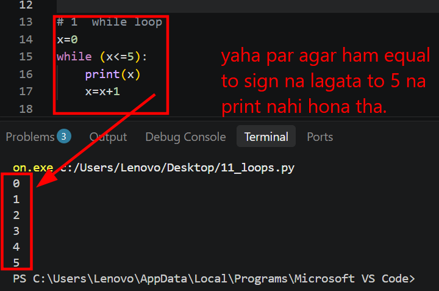

Above picture ma ham na x ke value 0 rakhi ha or while loop ka use keya ha or condition ya rakhi ha ka 0 sa la ka kar 5 tak print ho gay to 1 print hona ka bad x ke value ma ak + ho ga us vaqt tak program repeat hota raha ga gab tak 5 na ho gaya.

Phir ham for loop ka bara ma parta ha ka for loop kaya ha or hum ic khu use karta ha.
- for loop sa murad asa loop ha jesa ham uc gaga use karta ha gahaa hama pata hota ha ka ka ic code ko ketni bar print karvana ha.Yani hama maloom hota ha ka ham na ic code ko 10 / 20 ya 50 bar matlab apni mari ka sath print karvana ho vaha par ham for loop ka use karta ha. 

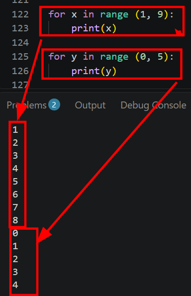

Above picture ma ham na for loop use kar ka 2 program execute keya ha Pahla program ma ham na ak limit de ha ka print karo 1 sa la kar 8 tak or dosara program ma ham na limit de ha ka print karo 0 sa 4 tak.

Array sa kaya murad ha? Python ma array sa murad ha ka ham ak he variable ma multiple value ko store kar sakta ha.

Ac ka bad ham labrires ka bara ma partha ha, labrary sa murad radimate code or tools ka magmova ha gnhaa ham program ma use kar sakta ha ic sa hamara kam easy ho gata ha hamma pora code shoroo sa erite nahi karna parta. 

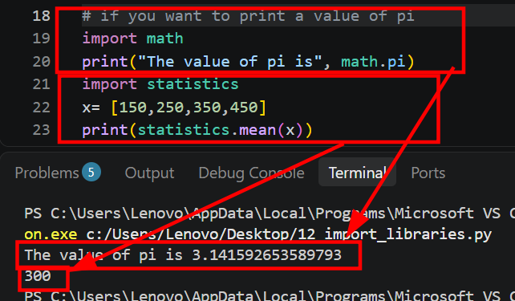 

Ac ka bad ham trouble shooting ka bara ma parta ha ka trouble shooting kaya ha or ic ka kaya use ha,Trouble shooting sa murad programming karta hova gab koi error aya gata ha to trouble shooting ka ya kam hota ha ka vo problem or error ko find karta ha us ke vaga ko find karta ha or usaa solve karta ha ic tamam process ko trouble shooting kahta ha.

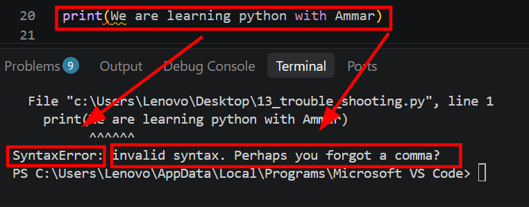

Above picture ma ha na strings ma ham na quotes ("") ka use ni kaya ic leya ya hama suntex error show kar va raha ha or hama bata raha ha ka shaid ap na comma use ni kaya ya syntax error ha.

# Lacture no 6 (Day 3)

Anaconda sa kaya murad ha or ham ica khu use karta ha?

Anaconda ak package software ha jo python ka sath bohat sa useful tools or labrires ak sath provide karta ha.  

Ac ka use data science,machine learning,or python ma programming ma hota ha.

>Jupyter notebook sa kaya murad ha or ic ka kaya use ha? 

Jupyter ak tool ha jis ma ham python ka code write karta ha or un code ko run karta ha or us ka result dakhhtaa ha.

Jupyter notebook ko ham ic leya use karta ha ta ka ham python ka code ka practic kar saka,or us ka result foren dakh sakaa,Data science or machine learning sekhana ka leya or graphs vagara vagara ko understand kar saka.

>Phir ham kernal ka bara ma parta ha ka kernal kaya ha or khu use karta ha?

Kernal ak program hota ha jo jupyter notebook ma python ka code ko run karta ha ya execute karta ha.

- Kernal ka bagar jupyter notebook python ka code execute nahi kar sakta.
- Ya variables ke value ko memory ma store karta ha.
- Calculation karta ha or code ka result ko notebook ko vapis data haa.
- Kernal restart sa murad variable ke porani value ko delete karta ha ta ka variable ko edit kar ka dobara use keya ga saka.

> **Phir ham par apna account banana ha. Sab sa pahla ham Github ka bara parta ha ka github ha kaa**

**Github ak online plateform ha jaha par devalopers or programmers coding ka kam yani software ka code ko store karta ha, share karta or aps ma mil kar kam kar sakta ha.**

- Ab bat karta ha ka github ka account kasa banana ha sab sa pahla ham na chrome par ga kar search karna ha ka *Github.com* to plateform open ho gaya ga phir hama screen par upper right side par **Sign up** ka button show ho gaya us par click karna ha.

- Phir e-mail ka box ma ham na e-mail ko write karna ha ic ka bad ham sa user name ka bara ma question ho gaya last par ya pochaa gaya ga country ko select karo or finelly hamara github ka account ban gaya ga.

Github ko use karn ka leya git ka hona zarori ha.

**Git kaya ha?** Git ak control version system (CVS) ya softwere ha jisa devalopers apna code ko menage karna ka leya or ic ma version k Change hona vala record ko store karna ka leya use karta ha.

Git ka bagar github ko use nahi kar sakt, Github par code ko upload karn or usa menage karna or
team ka sath mil kar kam karna ka leya Git softwere ka hona lazmi ha.

Github ak online plateform ha gaha par devalopers or programmers coding yani software ka code ko store karna, share karna or aps ma mil kar team ke tara kam karna.

Git ak control version system CVS softwere ha go code ko menage karta ha or go version change hota ha us ka record ko store karta ha.

Git ka bena github koi kam perform nahi kar sakta.